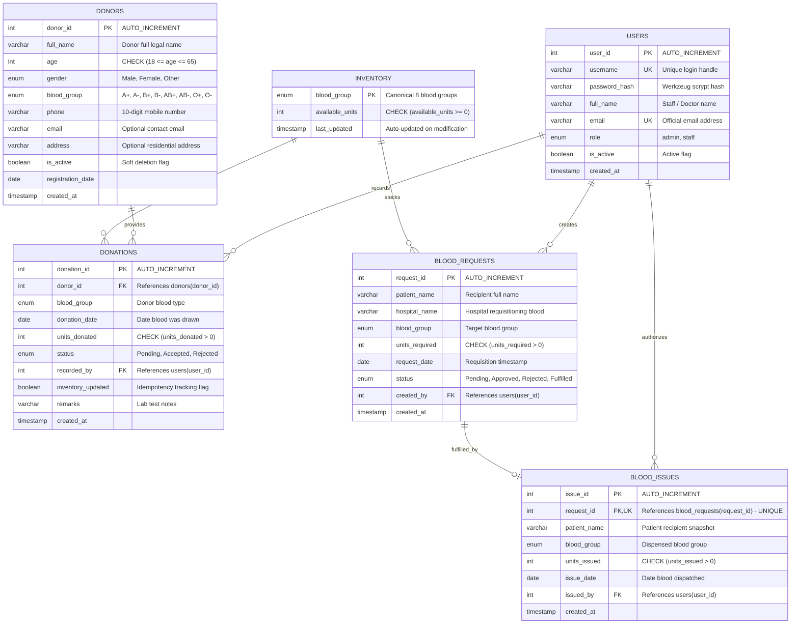

# Entity-Relationship (ER) Diagram & Normalization Analysis

## Blood Bank Donation and Issue Management System
**Department of Computer Science & Engineering — DBMS Project Documentation**

---

## 1. Relational Database ER Diagram (Mermaid)

The following Mermaid diagram illustrates the 6 core entities, their primary keys (`PK`), foreign keys (`FK`), and cardinalities.

---

## 2. Cardinality Analysis & Relational Mappings

1. **USERS to DONATIONS (1 : M)**
   - One staff user can intake and record multiple blood donations over time.
   - Each donation is verified and recorded by exactly one registered user (`recorded_by`).

2. **DONORS to DONATIONS (1 : M)**
   - A single registered donor can make multiple voluntary blood donations across different dates.
   - Each donation session is mapped to exactly one unique registered donor (`donor_id`).

3. **USERS to BLOOD_REQUESTS (1 : M)**
   - A staff member or admin can log multiple hospital blood requests.
   - Each blood request stores the creator's ID (`created_by`).

4. **BLOOD_REQUESTS to BLOOD_ISSUES (1 : 1)**
   - Each approved blood request can be fulfilled at most once (`request_id` is defined as `UNIQUE` in `blood_issues`).
   - A blood issue cannot exist without an underlying approved blood request (`request_id` is `NOT NULL` and references `blood_requests`).

5. **USERS to BLOOD_ISSUES (1 : M)**
   - A registered medical officer/admin can authorize and dispatch multiple blood issues.
   - Each issue record references the authorizing user (`issued_by`).

6. **INVENTORY to DONATIONS & ISSUES (Aggregation Entity)**
   - `inventory` stores exactly 8 canonical rows (one per blood group: A+, A-, B+, B-, AB+, AB-, O+, O-).
   - Accepted donations atomically increment `available_units`.
   - Completed issues atomically decrement `available_units` with a database check constraint (`available_units >= 0`) ensuring no stock can drop below zero.

---

## 3. Database Normalization (1NF, 2NF, 3NF)

A core requirement of database design is eliminating anomalies (insertion, deletion, and update anomalies) and redundancy through normalization.

### 3.1 First Normal Form (1NF)
**Criteria:**
- Every column contains atomic (indivisible) values.
- There are no repeating groups or arrays.
- Each row is uniquely identifiable by a Primary Key.

**Compliance in our schema:**
- In `donors`, attributes like `full_name`, `age`, `gender`, `phone`, and `email` contain single atomic scalar values (no comma-separated phone lists or nested structures).
- Every table has a clearly defined primary key (`user_id`, `donor_id`, `donation_id`, `blood_group`, `request_id`, `issue_id`).
- All attributes adhere to well-defined SQL datatypes (`INT`, `VARCHAR`, `ENUM`, `DATE`, `TIMESTAMP`).

### 3.2 Second Normal Form (2NF)
**Criteria:**
- The table must already satisfy 1NF.
- There must be no **Partial Functional Dependencies**: all non-prime attributes must be fully functionally dependent on the entire Primary Key.

**Compliance in our schema:**
- In all tables (`users`, `donors`, `donations`, `blood_requests`, `blood_issues`), the primary keys are single-column keys (`INT AUTO_INCREMENT` or `blood_group` enum).
- When a primary key consists of a single attribute, partial dependency is mathematically impossible because any non-key attribute cannot depend on a proper subset of a single-attribute key.
- Hence, all tables unconditionally satisfy 2NF.

### 3.3 Third Normal Form (3NF)
**Criteria:**
- The table must already satisfy 2NF.
- There must be no **Transitive Functional Dependencies**: no non-prime attribute should be functionally dependent on another non-prime attribute ($X \rightarrow Y$ where $Y$ is not a superkey and $X$ is not a primary key).

**Compliance in our schema:**
- In `donations`:
  - `donor_id` is a foreign key. The donor's address, phone, age, and registration date are **not** stored in `donations`. If they were, changing a donor's phone number would cause update anomalies across past donations.
- In `blood_requests`:
  - Only requisition details are recorded; staff profile details (`username`, `email`, `role`) are retrieved through `FOREIGN KEY (created_by) REFERENCES users(user_id)`.
- In `blood_issues`:
  - `blood_issues` links directly to `request_id`. For legal and medical audit integrity (snapshot trail), `patient_name` and `blood_group` are verified at issue time and protected by database transactions.
- In `inventory`:
  - Only live stock balances per blood group are tracked, avoiding duplicated calculation overhead while remaining strictly normalized.

**Conclusion:** The database schema is fully compliant with Third Normal Form (3NF), minimizing storage redundancy while guaranteeing data consistency.
